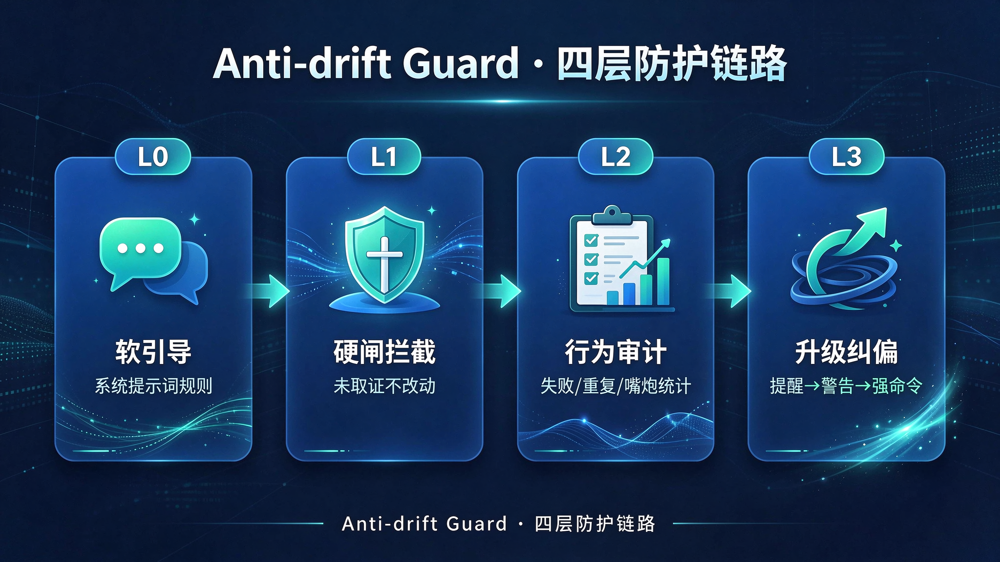

# dsh-anti-drift

> **本插件仅供分享学习，无其他用途。**
> **For sharing and study only — not for any other purpose.**

一个 DeepSeek Harness（DSH）插件：从引擎层面 **防吹牛、防死循环、防原地踏步**，约束 AI 只讲有依据的事实、不瞎编路径/接口/输出、不重复同一动作、不嘴上说说已完成。


---

## 它解决什么问题

在长会话、多工具协作场景下，模型容易出现几类典型“跑偏”：

- **瞎编**：编造文件路径、接口、函数签名、命令输出、报错、引用或数字；
- **嘴炮**：没有对应的成功工具调用，就声称“已完成 / 已修改 / 已部署”；
- **原地打转**：同一操作反复失败、反复重试，换个说法复读同一句话；
- **盲改**：本会话从没读过某个文件，就凭猜测去 `edit`，或用破坏性命令碰未取证的路径。

`dsh-anti-drift` 在 DSH 运行时挂上四道防线，把这些行为从“事后看日志才发现”变成“当场拦截 / 当场纠偏”。

## 四层防护



| 层 | 钩子 / 位置 | 机制 | 作用 |
|---|---|---|---|
| **L0 软引导** | `systemPrompt.section` | 向系统提示词注入规则段 | 只讲有依据的事实；拿不准就说“不确定”；完成需证据；不空转、不复读 |
| **L1 硬闸** | `tools/pre-execute` | 执行前拦截 | 拒绝盲改本会话未读过的文件（`edit`）；拒绝 `rm / mv / 重定向 / sed -i / tee / dd` 等破坏性 shell 命令触碰未取证路径 |
| **L2 审计** | `tools/result` + `session/event` | 逐会话统计“幻觉指纹” | 连续“找不到”失败、同一操作重复、猜测式措辞、“声称已完成却无成功工具佐证” |
| **L3 纠偏** | `agent/pre-step` | 下一步注入升级式消息 | 越界时在进入模型前注入纠偏消息：提醒 → 警告 → 强命令；压力渐进衰减，持续犯错会被紧接捕获 |

### L1 硬闸具体拦什么

- **盲改文件**：`edit` 目标路径在本会话从未被 `read` 成功读取 → 直接 `deny`，要求先读真实内容再改。
- **破坏性 shell 写操作**：识别 `rm / unlink / rmdir / shred / truncate`、`mv / cp` 源路径、`sed -i`、`dd of=`、`tee`、输出重定向 `>` / `>>`；目标路径本会话未取证 → 拦截。
- 新建文件的 `write` 不受此闸限制（作者已持有完整内容，属于合法新建）。

### L2 审计的四类信号

| 信号 | 识别依据 |
|---|---|
| 猜测失败 | 工具结果报错中出现 `not found / no such file / ENOENT / 不存在 / 找不到` 等 |
| 原地打转 | 连续两次以上相同工具调用（同名 + 同参数签名）无新进展 |
| 猜测措辞 | 出现“应该是 / 大概是 / 我记得 / 假设 / probably / I guess”等 hedge 表达 |
| 无据声称完成 | 文本出现“已完成 / 已创建 / fixed / deployed …”，但本会话尚无写入或命令类成功调用佐证 |

### L3 纠偏的三级强度

1. **提醒**：停止编造，只用已成功读取/运行得到的内容；
2. **警告**：仍未纠正则禁止再编造路径/命令/输出/结论，必须换具体做法；
3. **强命令**：只输出证据可支撑的内容，无法确认的部分明确写“无法确认”，无法推进就如实汇报卡点。

## 安装

### 方式一：DSH 界面添加

1. 把本目录（含 `index.js`、`client.js`、`package.json`、`cordis.patch.yml`、`locale/`、`icon.svg`）放到 DSH 可访问的位置；
2. 在 DSH 中打开 **Plugins → Add plugin**，选择本目录；
3. 安装后 Host 日志会打印一行提醒：本插件仅供分享学习，无其他用途。

### 方式二：插件管理器安装

通过 `plugin_manager` 的 `install_bundle` 指向本目录（或对应的 `.tgz` 包）即可。

## 配置

配置写在 `cordis.patch.yml`：

```yaml
- insert:
    - id: anti-drift
      name: 'dsh-anti-drift'
      config:
        language: auto            # auto / zh / en（auto 回落 zh）
        strictness: standard      # standard / strict
        enforce: true             # 总开关；false 仅保留提示词层，零额外请求
        blockBlindEdit: true      # 拦截对未读文件的盲改
        blockShellWrite: true     # 拦截破坏性 shell 命令触碰未读路径
        detectFalseClaims: true   # 检测“无据声称完成”
        repeatCancelThreshold: 3  # 同一操作重复几次判定原地打转
        correctionThreshold: 2    # 连续几次“找不到”触发纠偏
```

| 字段 | 默认 | 含义 |
|---|---|---|
| `language` | `auto` | 提示词与拦截消息语言：`auto` / `zh` / `en` |
| `strictness` | `standard` | 规则强度：`standard`（七条细则）/ `strict`（硬性精简版） |
| `enforce` | `true` | 总开关。`false` 仅保留 L0 提示词层，不挂任何额外钩子、不额外发起模型请求 |
| `blockBlindEdit` | `true` | 是否拦截未读文件的盲改 |
| `blockShellWrite` | `true` | 是否拦截破坏性 shell 写命令触碰未读路径 |
| `detectFalseClaims` | `true` | 是否检测无据“完成”声称与猜测措辞 |
| `repeatCancelThreshold` | `3` | 同一操作重复达到该次数，判定原地打转并累计压力 |
| `correctionThreshold` | `2` | 连续“找不到”/猜测措辞达到该次数，触发纠偏 |

## UI 状态面板

输入框（composer）下方会挂一个状态小徽章：

- 🟢 **绿色**：本会话暂无幻觉 / 空转信号；
- 🟡 **黄色**：出现 1–2 项异常；
- 🔴 **红色**：异常累计达到 3 项及以上；
- **点击徽章**展开明细：猜测失败次数 · 原地打转次数 · 无据声称完成次数。

> 面板数据是客户端对当前会话事件窗口的**近似统计**，用于快速观察；Host 侧的审计与拦截以服务端钩子为准。

## 目录结构

```
anti-drift-plugin/
├── index.js              # Host 侧：L0/L1/L2/L3 四道防线逻辑
├── client.js             # Client 侧：composer 下方状态徽章
├── cordis.patch.yml      # 插件装配与默认配置
├── package.json          # 插件元信息、导出入口、DSH 声明
├── locale/
│   ├── zh.json           # 中文元信息
│   └── en.json           # 英文元信息
├── icon.svg              # 插件图标
├── assets/               # 文档配图
└── README.md
```

## 工作边界与限制

- 插件只在本地对当前会话的 AI 行为做约束与统计，**不额外发起模型请求，不上传数据**。
- 启发式的命令 / 措辞识别存在边界：复杂 shell 组合、嵌套引号、动态拼接路径可能识别不到，属正常限制。
- “已读取证”以本会话成功 `read` 为准；跨会话、跨窗口不继承。

## License

MIT（仅供分享学习使用）。
